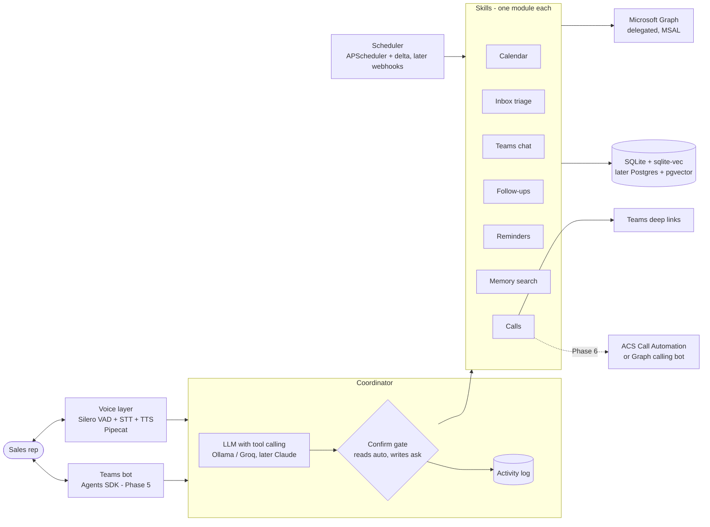

# Sales voice assistant: phased roadmap
_Drafted 2026-10-27. Vendor facts, prices and limits were checked against official docs on that date. Re-check them before choosing a vendor._

## Context
Sales reps live in Outlook and Teams and lose time on admin: booking and moving meetings, chasing follow-ups, deciding which mail matters. OpenAI's Dots shows the pattern we want: a personal, always-on assistant with memory and permissions. Ours is narrower and voice-first, built for sales reps on Microsoft 365.

**End goal.** A voice assistant that can:
- create, move and delete meetings
- set reminders
- capture follow-ups after every meeting and remember them
- give an end-of-day summary
- sort mail and Teams chats into urgent, important and reply-today
- place Teams calls on request, including calling the rep and being called by the rep

**Decisions so far:**

| Decision | Choice |
|---|---|
| Language | Python |
| Where phases 0–3 run | The local laptop |
| First Microsoft 365 tenant | A developer/test tenant (not the company tenant) |
| Early-phase APIs | Free or free-tier only; paid vendors chosen later |
| Call directions | All three: rep → contact, assistant → rep, rep → assistant |

## Architecture


## Principles (every phase)
1. **One module per skill.** Calendar, inbox, chat, follow-ups, reminders, memory and calls each sit in their own module and register their tools with the coordinator. Adding HR or IT later must not touch sales code.
2. **Swappable vendors.** LLM, STT, TTS, embeddings and the vector store each sit behind one Python `Protocol`. Moving from free to paid is a config change.
3. **Reading is automatic; acting needs a yes.** Creating, moving, deleting, sending or calling requires a spoken or clicked confirmation. Every tool call is written to `activity_log`.
4. **Client data stays private.** Mail and chat content only goes to the local LLM, or to a paid provider with no-training terms. It never goes to free tiers that train on inputs (Gemini free).
5. **Evaluate before moving on.** `evals/commands.yaml` holds about 30 utterances, each with the tool call it should produce. Each phase must pass its exit check.

## Phases

### Phase 0: foundations and text brain
- **Build:**
  - Tenant setup.
  - Entra app registration.
  - MSAL device-code login with a token cache.
  - FastAPI app.
  - Swappable LLM (Ollama qwen3 or Groq gpt-oss).
  - Calendar tools: `list_meetings`, `find_slot`, `create_teams_meeting`, `move_meeting`, `delete_meeting`.
  - Confirm gate.
  - SQLite activity log.
  - A simple text chat page or CLI.
- **Graph permissions (delegated):** User.Read, Calendars.ReadWrite, People.Read, MailboxSettings.Read (time zone and working hours), offline_access.
- **Exit check:** "Book 30 min with Raj tomorrow afternoon" creates a Teams meeting after confirmation. At least 90% of the eval set produces the correct tool call.
- **Risk:** the sandbox needs a qualifying account (Visual Studio subscription, partner, or Premier/Unified support). The fallback is a Microsoft 365 Business trial tenant.

### Phase 1: voice and call links
- **Build:**
  - Browser voice page.
  - Pipecat pipeline: SmallWebRTC, Silero VAD, faster-whisper (int8), Kokoro TTS.
  - Barge-in, so the rep can interrupt.
  - `call_person(topic)`: resolve the person through Graph People/contacts, then return a Teams call deep link or a chat deep link with the topic pre-filled.
- **Exit check:** under about 1.5 s from end of speech to the first audio of the reply on the laptop. Call links open the right person.
- **Free → paid:** STT moves to Deepgram Nova-3 or Azure Speech; TTS moves to Deepgram Aura-2 or Azure neural voices.

### Phase 2: mail and Teams triage, reminders
- **Build:**
  - Scheduled delta sync of the inbox and chats into SQLite.
  - Triage score in two parts:
    - Rules from Outlook's own signals: `importance`, `flag`, `inferenceClassification`, due dates, VIP/client sender list.
    - An LLM check that labels each message urgent, important, reply-today or later, with a one-line reason.
  - Reminders created as To Do tasks.
  - Voice commands: "what's urgent?" and "remind me to…".
- **Graph permissions:** Mail.ReadWrite, Chat.Read, Tasks.ReadWrite.
- **Exit check:** on 50 hand-labelled messages, urgent recall is at least 85%. A reminder shows up in To Do / Outlook.

### Phase 3: meeting follow-ups and memory
- **Build:**
  - After each meeting, get its content one of two ways:
    - the Teams transcript, if an admin has consented;
    - otherwise "debrief me": the rep dictates notes.
  - Extract action items with owner and due date, then write them to SQL and To Do.
  - Draft a follow-up email for the rep to approve.
  - Vector memory (sqlite-vec or Chroma, nomic-embed-text) over mail, chats, transcripts and notes.
  - "What did I promise Raj?" answers with a cited source.
- **Graph permissions:** OnlineMeetingTranscript.Read.All. It needs **admin consent**, and the tenant must allow transcript access.
- **Exit check:** action items are correct for 5 sample meetings. Questions about past promises return the right source.

### Phase 4: proactive assistant
- **Build:**
  - Morning brief, end-of-day summary, overdue follow-up nudges.
  - Graph change notifications through a dev tunnel, with automatic renewal: mail and events up to 7 days, chats 3 days. Scheduled delta sync stays as the backup.
  - Deliver nudges as a Teams chat message or an email to self.
- **Exit check:** the end-of-day summary arrives on time for 5 days in a row. An urgent new mail produces a nudge within about 1 minute.

### Phase 5: ship inside Teams
- **Build:**
  - Microsoft 365 Agents SDK (Python) bot with the Agents Toolkit and Teams SSO.
  - Proactive messages from the bot.
  - Azure Bot Service F0 (unlimited messages on the Teams channel).
  - Hosting moves to Azure App Service, with storage on Postgres + pgvector.
  - Switch to the paid vendors chosen by then (likely Claude Haiku 5.5 for triage and extraction, Sonnet 5.5 as coordinator).
- **Exit check:** a rep uses every Phase 0–4 feature from Teams chat.
- **Note:** don't use the Bot Framework SDK. It was retired in Dec 2025 and its repo archived in Jan 2026.

### Phase 6: real voice calls through Teams
- **First, a prototype comparing two options:**
  - **A.** Azure Communication Services Call Automation. Teams interop with two-way audio streaming, Python, pay per minute (about $0.004 per participant per minute).
  - **B.** A Graph calling bot with app-hosted media. C#/.NET only, Windows VMs on Azure, admin consent for `Calls.*`.
- **Then build:**
  - The assistant calls the rep with the brief.
  - The rep calls the assistant hands-free.
- **Until then,** a mobile-friendly voice web page covers hands-free use.
- **Exit check:** a rep on Teams mobile holds a 2-minute spoken conversation with the assistant.

### Phase 7: extras backlog
Pick these one at a time:
- pre-meeting brief
- client company research
- CRM sync (Salesforce, HubSpot, Dynamics)
- sentiment and deal-risk score
- pipeline by voice
- proposal generator
- Hindi and Gujarati support
- expense logging
- live meeting coach

## Repo layout
```
frontend/           browser pages (chat, Activity Log); voice UI joins here in Phase 1
backend/
  app/
    graph/          MSAL auth
    skills/calendar/   (more skills: inbox, chat, followup, reminders, memory, calls)
    providers/      LLM clients behind one interface (later: stt, tts, embed, vector)
    core/           coordinator, confirmation gate, Activity Log, session
    web/            HTTP API for the frontend
    voice/          Pipecat pipeline (Phase 1)
    scheduler/      APScheduler jobs, delta sync (Phase 2+)
  evals/commands.yaml
  tests/
docs/
```

## How we'll work
- **Once:** run `/setup-matt-pocock-skills`.
- **Per phase:**
  1. `/grill-with-docs` to settle the details and start `GLOSSARY.md` and ADRs.
  2. `/to-spec`, then `/to-tickets`.
  3. `/implement` each ticket, test-first with `/tdd`.
  4. `/code-review`.
  5. `/retro`.
- **Human-only setup steps** (tenant, Entra app, admin consent): use a `/wizard` script.
- **Prototypes** (Phase 1 latency, Phase 6 calling): use `/prototype`.

## Open decisions
| Decision | Why it matters | Needed by |
|---|---|---|
| Tenant: does Collabera qualify for the E5 sandbox (Visual Studio subscription, partner, or Premier support), or do we use a Business trial? | Blocks Phase 0 | Before Phase 0 |
| Admin consent for transcripts, and permission for transcript access in the company tenant | Without it, Phase 3 uses dictated notes only | Before Phase 3 |
| Paid LLM and speech vendors | Cost and quality from Phase 5 | Before Phase 5 |
| Calling route: ACS (A) or Graph calling bot (B) | Adds a C#/Windows component and per-minute cost | Phase 6 prototype |
| Data storage location and retention rules for client mail and transcripts | Privacy and compliance | Before Phase 2 |
