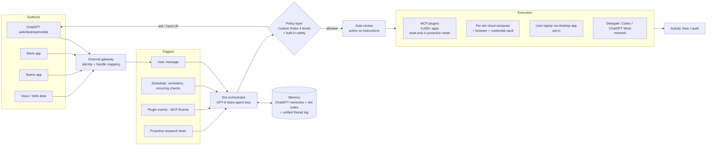

# OpenAI Dots: reverse-engineered teardown
_As of 2026-10-27. Built from public sources; every claim is tagged in the evidence ledger at the bottom (E# = sourced fact, I# = my inference)._

## TL;DR
- **What it is:** a single, named, always-on agent per ChatGPT user ("your dot"), powered by GPT-6 Astra, with its own cloud computer and browser, reachable from ChatGPT, Slack, Teams and voice, connected to 4,000+ apps via plugins (E1–E3, E9).
- **Key architectural bet:** the dot is not a new runtime. It is a **persistent identity + memory + trigger layer** sitting on top of the agent stack OpenAI already ships (ChatGPT Work, Codex cloud, Agents API, MCP plugins). It talks for free and hands heavy work to metered products (I1, I7).
- **Safety model:** two capability modes. Proactive background work uses **read-only tools only**; actions go through a 4-level rule policy plus an "auto-review" check (E5–E7, I4, I5).
- **Business tell:** chat with the dot is unmetered, but work it starts in Codex/ChatGPT Work counts against limits, and you only get one dot. The scarce, costly resource is the always-on computer and the agentic compute, not the conversation (E15, E18, I7, I8).
- **Maturity:** six weeks old, one dot per user, region-restricted, an enterprise outage on 2026-10-22, and sidebar bugs across clients (E17, E18, E29, E30).

## What it does (user-visible)
- You create a dot on web, desktop or mobile, name it, and pick an avatar. Its default handle is `@yourname-dot` (E10, E14).
- You give it projects, things to watch, or goals. It "keeps that context instead of starting over" and works "24/7" (E35).
- It reads connected apps **proactively** and forms memories even when you haven't asked (E12). In that mode it "can't send messages, change app content, or control your browser" (E5).
- It acts through its own cloud browser and computer, optionally through your laptop (opt-in, desktop app must be open) (E2, E11).
- It sets reminders and recurring checks, which you manage in a **Scheduled** list (E13). It can also start or continue Codex threads and edit ChatGPT Work scheduled tasks (E14).
- You inspect it via **Activity View** and by opening its cloud computer (E8).
- Hard limits: it can't call you, has no email address of its own, and can't change passwords. **Pause** and **Reset** (which deletes conversations, memories and scheduled tasks) are the kill switches (E12, E23, E34).

## Architecture

### Surfaces
- **Most likely:** one conversation per dot, with Slack, Teams and SMS acting as channel adapters into the same thread and memory. The owner's identity is mapped by a shared OpenAI bot app, which is why the Slack handle is normalised to `@owner-dotname` (E9, E10). (I10, med)
- **Alternative:** a separate thread per channel, bridged only through long-term memory.
- **Tell-apart signal:** in Slack, ask about a detail you mentioned only minutes earlier in the mobile app. If it answers verbatim from short-term context, the thread is unified. If it recalls only a gist, or nothing, the bridge is memory.

### Runtime and compute
- **Most likely:** a **dedicated, persistent VM per dot** that holds browser profile and cookie state, with saved credentials injected without the model seeing passwords. Evidence: "own cloud computer (access always on)", the open-its-computer inspection, and credential handling (E2, E11, E22). (I2, med-high)
- **Alternative:** an ephemeral sandbox from a shared pool, snapshotted to disk and restored when the dot wakes. This is cheaper but loses live state.
- **Tell-apart signal:** after a day idle, do open tabs, downloaded files and logged-in sessions survive, and is the first action noticeably slow (a cold restore)? The one-dot-per-user cap (E18) fits a design where each dot carries a real standing compute cost (I8).
- **Laptop access:** the desktop app is most likely an outbound-connected remote executor, because it requires "ChatGPT open and online" (E11). (I12, high)

### Core loop
- **Most likely:** an event-driven agent. A trigger (message, schedule tick, plugin event, proactive timer) wakes the dot. The dot loads its memory and runs a GPT-6 Astra plan-act loop. Each action is checked by the policy layer and auto-review. Long or heavy work is delegated to Codex or ChatGPT Work threads rather than run inline (E13, E14, E28). (I3, med-high)
- The Agents API publicly exposes the same primitives: computer use, multi-agent, tool search, context compaction, OpenAI-managed execution (E26). That suggests dots are built on it or alongside it (I1).
- **Alternative:** a long-lived process that keeps polling continuously.
- **Tell-apart signal:** "can work across multiple projects at the same time" (E36) and the delegation to Codex both favour fan-out to sub-runs over one long process. Watch Activity View for parallel runs with separate IDs.

### State and memory
- **Most likely:** three stores. (1) Inherited **ChatGPT memories**. (2) **Dot-private notes and memories**, formed partly from proactive reading. (3) A conversation and activity log. Reset wipes (2), (3) and scheduled tasks. Disconnecting an app does *not* delete what was already ingested (E12, E24). (I6, high)
- **Alternative:** retrieval over the raw ingested app data instead of distilled memories.
- **Tell-apart signal:** the help text says it "forms memories from" app data and that disconnecting keeps them, which points to distilled copies. Check whether **Customize > Memory** lists items sourced from email or Slack.

### Integrations
- **Most likely:** the same **MCP-based plugin layer** as ChatGPT Work and Codex, with one permission grant shared across products. Permissions are granular (for example, read mail but not send) (E3, E4, E37).
- **The read-only proactive mode** implies each tool is tagged read or write, and the proactive run gets a filtered toolset (I4, high).
- **Event triggers:** the new **MCP Events** spec is the likely way an external change (new email, ticket update) wakes a dot (E28). (I3)

### Triggers and scheduling
- **Confirmed:** user messages, reminders and recurring checks, plus event-triggered automations (E13, E21).
- **Inferred:** proactive research runs on a periodic background sweep. Its cadence is unpublished (U2).

### Permissions and safety
- **Confirmed:** Custom Rules have four levels: act without asking / act if pre-approved (explicitly in your prompt) / ask first / hand off to you (E6). Built-in safety rules always apply, and auto-review checks consequential actions (E7). Password changes are human-only (E23).
- **Most likely:** auto-review is a **separate monitor model** that grades each proposed action against the user's instructions and policy, the same pattern as Codex auto-review. (I5, med)
- **Alternative:** a deterministic rules engine only.
- **Tell-apart signal:** whether it blocks actions that no explicit rule covers but that plainly exceed the instruction's scope.
- **Context:** OpenAI held back GPT-6.1 Astra because it fell short "in terms of staying within scope and authorization" (E33). Scope adherence is the known weak point, which explains the layered defences.

### Observability
- Activity View and the live cloud computer view (E8). Scheduled tasks are listed per dot (E13). No exportable audit log is documented for individuals. For enterprise specialist dots, Microsoft Agent 365 integration is in development (E21).

### Business model and limits
- The first dot is included with Pro ($100 / $200 / $500 tiers) and Business Premium. Enterprise, Edu and Healthcare get a beta that is off by default. Not available in the EEA, Switzerland or the UK (E16, E17, E20).
- Chat is unmetered. Work started in Codex or ChatGPT Work is metered against those limits (E15). Future pricing will be by "speed or … work per month" (E19).
- **Reading:** the dot is priced as a **seat-bundled orchestrator**. Its marginal cost sits in agentic execution, so OpenAI meters that and leaves the chat free. The Pro 200 allowance halves on 2026-10-30, right after launch-month limits end (E20). That suggests real usage costs more than the launch generosity implied. (I7, high)

## Design tradeoffs (why they likely built it this way)
| Choice | Why | What it costs them |
|---|---|---|
| Reuse the Work/Codex/Agents API runtime (I1) | Fast to ship (Codex cloud, plugins and computer use already existed). One permission model and one billing meter. | The dot inherits those products' limits and failure modes. Users face confusing multi-product metering (E15, E20). |
| Persistent per-dot computer (I2) | Logged-in browser state and visible "it's working" UX. Handles sites with no API. | Standing compute per user, which explains the one-dot cap and Pro-only access (E18). |
| Read-only proactive mode (E5) | Lets the dot be "always on" without unsupervised writes. Contains prompt injection from inbound email and Slack. | Proactive value is limited to noticing and suggesting. Real action still waits on a user turn or a pre-approved rule. |
| Memories formed from app data (E12) | Personalisation without re-reading sources every time. | A privacy surprise: disconnecting doesn't delete. Likely regulatory friction, and plausibly part of why the EEA, CH and UK are excluded (I13, low). |
| One identity across Slack, Teams and ChatGPT (E9) | The "coworker" positioning. Specialist dots with org identity and credentials are the enterprise wedge (E21). | Cross-tenant identity mapping. The enterprise message path failed for about 2h on 2026-10-22 (E29). |
| Cartoon avatar persona (E38) | Makes delegation feel safe and personal; competes with Meta's Muse. | The persona over-promises. A dot claimed it could build a five-dot team that the account didn't support (E31). |

## Open unknowns
| Question | Why it matters | How to find out |
|---|---|---|
| U1. Does the cloud computer keep files, tabs and sessions between unrelated tasks and after days idle? | Settles persistent VM versus snapshot/pool (I2), and the cost structure. | Leave a file and a logged-in tab, return 48h later, and open its computer. |
| U2. How often does proactive research run, and what does it read? | Sets cost, privacy exposure and the injection surface. | Connect a test inbox, send timestamped mails, and watch when memories or Activity View entries appear. |
| U3. Is auto-review a model or rules? | Determines how robust the safety layer is against novel actions. | Give a narrow instruction and see whether out-of-scope but unruled actions get blocked, and with what explanation. |
| U4. Is the conversation unified across channels? | Architecture of the channel gateway (I10). | Run the Slack-versus-mobile recall test above. |
| U5. Price of extra dots and of "speed" tiers | The real unit economics. | Watch openai.com/chatgpt/pricing and the help centre after 2026-10-30. |
| U6. Why the EEA, CH and UK are excluded | Regulatory versus infrastructure (data residency of VMs). | Check OpenAI's EU statements, and whether Enterprise EU tenants with residency get the beta. |
| U7. How prompt injection from proactively read content is handled beyond read-only tools | Memories formed from hostile email could steer later write actions. | Red-team your own dot with a crafted email, then check memory and later behaviour. |

## Evidence ledger
| ID | Claim | Tag | Source / reasoning | Date |
|----|-------|-----|--------------------|------|
| E1 | Powered by GPT-6 Astra | Confirmed | [Introducing dots](https://openai.com/index/introducing-dots/) | 2026-09-29 |
| E2 | Each dot has its own cloud computer and browser | Confirmed | Introducing dots; [Getting started](https://help.openai.com/en/articles/20001530-getting-started-with-your-dot) ("access always on") | 2026-09-29 |
| E3 | Connects to 4,000+ apps via plugins | Confirmed | Introducing dots | 2026-09-29 |
| E4 | Plugins are MCP-based | Confirmed\* | Press on ChatGPT Work plugins; InfoQ on MCP Events | 2026-10 |
| E5 | Proactive research uses read-only tools; "can't send messages, change app content, or control your browser" | Confirmed | Introducing dots | 2026-09-29 |
| E6 | Custom Rules: act without asking / if pre-approved / ask first / hand off | Confirmed | Getting started | 2026-10 |
| E7 | Built-in safety always applies; auto-review checks actions against instructions | Confirmed | Introducing dots | 2026-09-29 |
| E8 | Activity View; you can open its cloud computer | Confirmed | Introducing dots | 2026-09-29 |
| E9 | Surfaces: ChatGPT web/desktop/mobile, Slack, Teams, voice | Confirmed | Introducing dots | 2026-09-29 |
| E10 | Default handle `@yourname-dot`; Slack normalises to `@owner-dotname` | Confirmed | Getting started | 2026-10 |
| E11 | Laptop access is opt-in, off by default, needs the desktop app open and online | Confirmed | Getting started | 2026-10 |
| E12 | Inherits ChatGPT memories and creates its own; forms memories from apps proactively; disconnecting doesn't delete data; Reset wipes conversations, memories and scheduled tasks | Confirmed | Getting started | 2026-10 |
| E13 | Reminders and recurring checks, managed in Scheduled | Confirmed | Getting started | 2026-10 |
| E14 | Can create a dot on mobile; can start or follow up Codex threads and edit ChatGPT Work scheduled tasks | Confirmed | [OpenAI community announcement](https://community.openai.com/t/fresh-dots-updates-create-in-the-mobile-app-delegate-to-codex/1404834) | 2026-10-09 |
| E15 | Dot conversations don't count toward limits; Codex/Work tasks it starts do | Confirmed\* | [eesel](https://www.eesel.ai/blog/openai-dots), quoting the launch post | 2026-10 |
| E16 | First dot included with Pro and Business Premium; Enterprise/Edu/Healthcare beta, admin-enabled, off by default | Confirmed | Getting started | 2026-10 |
| E17 | Pro users 18+, excluding EEA, Switzerland and UK | Confirmed | Getting started | 2026-10 |
| E18 | Only one dot per user today | Observed | [Community thread](https://community.openai.com/t/multiple-specialized-dots-with-shared-context-and-clear-task-ownership/1402778) | 2026-10-02 |
| E19 | Future scaling priced by speed or work per month | Confirmed | Introducing dots | 2026-09-29 |
| E20 | Pro tiers $100/$200/$500; Pro 200 allowance halves on 2026-10-30 | Confirmed\* | [beam.ai](https://beam.ai/agentic-insights/openai-dots-usage-limits-pro-200) (cites no first-party URL) | 2026-10-27 |
| E21 | Specialist dots pilot (org identity, credentials); Agent 365 integration in development; event-triggered automations | Confirmed\* | [VentureBeat](https://venturebeat.com/technology/openai-launches-dots-always-on-ai-agent-coworkers-and-chatgpt-space-where-they-can-collaborate-with-human-teams), [TechCrunch](https://techcrunch.com/2026/09/29/openai-launches-dots-its-bubbly-agentic-avatar/) | 2026-09-29 |
| E22 | Saved credentials are used without exposing passwords to the model | Confirmed\* | VentureBeat | 2026-09-29 |
| E23 | Password changes must be done by the human | Confirmed | Getting started | 2026-10 |
| E24 | Business/Enterprise/Edu content not used for training by default; proactive research and dot notes not directly trained on | Confirmed | Introducing dots | 2026-09-29 |
| E25 | ChatGPT Space replaces Library; dots can be @mentioned on shared Pages | Confirmed\* | VentureBeat | 2026-09-29 |
| E26 | Agents API: computer use, multi-agent, tool search, context compaction, OpenAI-managed execution; also in Codex and ChatGPT Work | Confirmed\* | [InfoQ](https://infoq.com/news/2026/10/openai-devday-2026) | 2026-10-02 |
| E27 | Computer use combines screenshots, accessibility tree, DOM and Playwright | Confirmed\* | [Ecosistema Startup](https://ecosistemastartup.com/openai-devday-2026-computer-use-180-mas-rapido-y-agents-api/), quoting OpenAI's computer-use lead | 2026-09-29 |
| E28 | MCP Events spec for triggering automations | Confirmed\* | InfoQ | 2026-10-02 |
| E29 | Enterprise outage: "failures sending messages to dots", about 2h | Confirmed | [OpenAI Status](https://status.openai.com/incidents/01M5JF8DR3EGQJNTXPZ24AKX2G) | 2026-10-22 |
| E30 | Dots missing from macOS and Android sidebars while web works | Observed | OpenAI community bug threads | 2026-10 |
| E31 | A dot claimed it could build a five-dot team the account didn't support | Observed | Community thread (E18) | 2026-10-02 |
| E32 | Live voice demo failed during the keynote | Observed | [NBC News](https://www.nbcnews.com/tech/tech-news/openai-launches-dots-ai-agents-safety-questions-rcna600338) | 2026-09-29 |
| E33 | GPT-6.1 Astra withheld over "staying within scope and authorization" | Confirmed\* | NBC News, quoting OpenAI's Head of Safety Systems | 2026-09-29 |
| E34 | Can't initiate calls at launch; no standalone email address; texting is a US-Pro-only beta | Confirmed | Getting started | 2026-10 |
| E35 | Works toward goals 24/7; keeps context instead of starting over | Confirmed | Introducing dots | 2026-09-29 |
| E36 | Can work across multiple projects at the same time | Confirmed\* | [IT Brief](https://itbrief.co.uk/story/openai-launches-dots-always-on-ai-agents-for-work) | 2026-09-29 |
| E37 | One plugin permission grant applies across ChatGPT, ChatGPT Work, Codex and dots; granular read/send | Confirmed\* | eesel | 2026-10 |
| E38 | Cartoon floating-dot avatar, compared to Meta's Muse | Observed | TechCrunch | 2026-09-29 |
| I1 | The dot is an identity/memory/trigger layer over the existing Work/Codex/Agents API runtime | Inferred (high) | E14, E15, E26, E37: shared permissions, delegation and shared metering | — |
| I2 | Persistent VM per dot rather than a pooled ephemeral sandbox | Inferred (med-high) | E2 "always on", E8 open-its-computer, E22 stored creds, E18 one-dot cap | — |
| I3 | Event-driven wake → plan/act loop, fanning out to sub-runs | Inferred (med-high) | E13, E14, E28, E36 | — |
| I4 | Tools tagged read/write; proactive runs get a read-only subset | Inferred (high) | E5, E37 | — |
| I5 | Auto-review is a separate monitor model | Inferred (med) | E7 wording "checks against instructions" is semantic; E33 shows scope as the known risk | — |
| I6 | Memory = inherited ChatGPT memories + dot notes + log; distilled, not raw RAG | Inferred (high) | E12, E24 | — |
| I7 | Chat is cheap and agentic execution is the cost centre, hence the metering split | Inferred (high) | E15, E19, E20 | — |
| I8 | Single-dot cap reflects standing per-dot compute cost | Inferred (med) | E2, E18, E19 | — |
| I10 | Shared OpenAI Slack/Teams bot with owner→dot identity mapping | Inferred (med) | E10 handle normalisation | — |
| I12 | Laptop access via the desktop app as an outbound remote executor | Inferred (high) | E11 | — |
| I13 | EEA/CH/UK exclusion partly driven by proactive memory formation and privacy law | Inferred (low) | E12, E17; no official reason given | — |

\* **Confirmed\***: reported by press or third parties and consistent with first-party material, but I could not find the original OpenAI wording. Treat these as strong pointers, not facts.

## Sources
- [Introducing dots — OpenAI](https://openai.com/index/introducing-dots/) — 2026-09-29
- [Getting started with your dot — OpenAI Help](https://help.openai.com/en/articles/20001530-getting-started-with-your-dot) — 2026-10
- [Fresh dots updates: create in mobile, delegate to Codex — OpenAI Community](https://community.openai.com/t/fresh-dots-updates-create-in-the-mobile-app-delegate-to-codex/1404834) — 2026-10-09
- [Multiple specialized dots — OpenAI Community](https://community.openai.com/t/multiple-specialized-dots-with-shared-context-and-clear-task-ownership/1402778) — 2026-10
- [Degraded Performance of Dots on Enterprise — OpenAI Status](https://status.openai.com/incidents/01M5JF8DR3EGQJNTXPZ24AKX2G) — 2026-10-22
- [VentureBeat: Dots and ChatGPT Space](https://venturebeat.com/technology/openai-launches-dots-always-on-ai-agent-coworkers-and-chatgpt-space-where-they-can-collaborate-with-human-teams) — 2026-09-29
- [TechCrunch: Dots, its bubbly agentic avatar](https://techcrunch.com/2026/09/29/openai-launches-dots-its-bubbly-agentic-avatar/) — 2026-09-29
- [NBC News: Dots amid safety questions](https://www.nbcnews.com/tech/tech-news/openai-launches-dots-ai-agents-safety-questions-rcna600338) — 2026-09-29
- [InfoQ: OpenAI DevDay 2026](https://infoq.com/news/2026/10/openai-devday-2026) — 2026-10-02
- [Ecosistema Startup: Computer Use and Agents API](https://ecosistemastartup.com/openai-devday-2026-computer-use-180-mas-rapido-y-agents-api/) — 2026-09-29
- [beam.ai: Dots usage limits and the Pro 200 cut](https://beam.ai/agentic-insights/openai-dots-usage-limits-pro-200) — 2026-10-27
- [eesel: OpenAI Dots explained](https://www.eesel.ai/blog/openai-dots) — 2026-10
- [IT Brief: OpenAI launches dots](https://itbrief.co.uk/story/openai-launches-dots-always-on-ai-agents-for-work) — 2026-09-29
